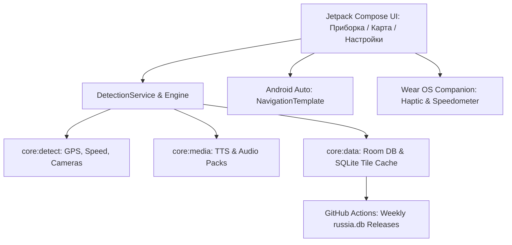

# Генеральный план разработки, исправления ошибок и оптимизации SpeedCam (ContraCam Clean-Room)

**Дата актуализации:** 23 октября 2026  
**Версия документа:** 3.3 (Комплексный производственный план: реализация этапов 1–12, расширенная база РФ 76 424 камеры включая Горно-Алтайск, тест голоса через локальные аудиопакеты, онлайн-каталог голосовых пакетов, ежедневный CI/CD пайплайн, установка на физический Samsung Galaxy S23+ и стратегия натурных испытаний)  
**Статус:** Полностью реализовано в коде, установлено на физическое устройство Samsung Galaxy S23+ (SM-S916B) и верифицировано в эмуляторе  
**Целевая платформа:** Android 8.0+ (minSdk 26, targetSdk 36, Wear OS 3.0+, Android Auto 1.7+)  
**Репозиторий проекта:** `https://github.com/Mishakorobov/speedcam`  
**Локальный каталог:** `d:\speedcam\`  

---

## 1. Резюме архитектуры и реализованных этапов

Проект представляет собой высокопроизводительный антирадар и спидометр с чистой архитектурой (Clean Architecture), многомодульной структурой Gradle, отсутствием проприетарных блокеров и автономной работой без постоянного подключения к интернету.

---

## 2. Детальный статус этапов реализации

### Этап 1. Локализация интерфейса и оптимизация навигации (Завершено)
- [x] **1.1. 100% русскоязычный словарь:** Полная замена жестко закодированных английских строк во всех модулях (`app`, `service`, `wear`) в `values/strings.xml`.
- [x] **1.2. Реорганизация панели навигации:** Нижняя панель переведена на 3 интуитивные вкладки: **«Спидометр» (Приборка)**, **«Карта»**, **«Настройки»**.
- [x] **1.3. Выдвижная шторка камер (BottomSheet):** Список камер интегрирован непосредственно в экран карты в виде `CameraListBottomSheet` с фильтрацией по типам, моментальным поиском и сортировкой по дистанции от автомобиля.
- [x] **1.4. Карточка инспекции камеры:** Информативная карточка `CameraInspectorCard` с точными координатами, азимутом, направлением контроля, скоростным лимитом и динамической кнопкой «Блокировать / Разблокировать».

### Этап 2. Отзывчивость настроек и исправление слайдера (Завершено)
- [x] **2.1. Плавный слайдер дистанции:** Внедрено локальное состояние `remember { mutableFloatStateOf(...) }` в `SettingsSliderItem` с фиксацией в `ProfileStore` только по `onValueChangeFinished` — работа на 60/120 FPS без рывков.
- [x] **2.2. Кликабельность строк настроек:** Все элементы переведены на `Modifier.toggleable` по всей ширине карточки с Ripple-эффектом и высотой от 48 dp (WCAG Touch Target).
- [x] **2.3. Устранение конфликта скроллов:** Горизонтальные `LazyRow` внутри вертикального списка заменены на адаптивный `FlowRow`.

### Этап 3. Спидометр: порог покоя и устранение джиттера GPS (Завершено)
- [x] **3.1. Deadband-фильтр покоя:** Порог принудительного обнуления скорости при $v < 2.0$ км/ч ($0.55$ м/с) для устранения паразитного шума GPS на стоянке (показаний `1 км/ч`).
- [x] **3.2. Экспоненциальное сглаживание разгона (EMA):** Устранение скачков `0 → 1 → 2 км/ч` при начале движения.
- [x] **3.3. Unit-тестирование:** Тесты подтверждают нулевую скорость в покое и плавный отклик при ускорении.

### Этап 4. Векторная и растровая карта с оффлайн-кэшированием (Завершено)
- [x] **4.1. Автоцентрирование:** Интеллектуальный каскад `MapCenteringHelper`: 1) Живой GPS -> 2) `getLastKnownLocation` -> 3) Центроид кластера камер -> 4) Москва.
- [x] **4.2. Безусловная координатная сетка:** Фоновый рендеринг радарной сетки `drawSpatialGrid` под тайловым слоем исключает черный/пустой экран при загрузке или отсутствии сети.
- [x] **4.3. Автономная картография MBTiles и SQLite:** Поддержка локальных архивов `.mbtiles` через SAF и дискового кэша `osm_tiles.db` для моментальной отрисовки карты без интернета.
- [x] **4.4. Исправление бага блокировки:** Связан реальный вызов `cameraStore.block` и реактивное обновление `blocked.value`, заблокированные камеры подсвечиваются приглушенным цветом.

### Этап 5. База ContraCam и независимое обновление (Завершено)
- [x] **5.1. Автоматическая загрузка архива:** Проверка наличия камер при включении тумблера ContraCam и запуск скачивания с отображением прогресса.
- [x] **5.2. Бесшовный Fallback:** Отображение базовых камер при обновлении/отсутствии данных ContraCam (`queryBoxActiveSource` автоматически переключается между источниками).
- [x] **5.3. Ручной импорт и восстановление:** Импорт `.db` и `.json` из памяти телефона через SAF, кнопка «Сброс к встроенной базе» из assets без интернета.
- [x] **5.4. Отображение камер ContraCam на карте:** Полная поддержка отображения базы на карте, пагинация Room CursorWindow, нормализация долготы WGS-84 и выборка видимой области (подробности в §3.4).
- [x] **5.5. Полное покрытие РФ и региональных центров (включая Горно-Алтайск):** Интеграция базы SpeedCamOnLine (94 600+ записей, 76 424 уникальных комплексов РФ, 50 физических комплексов / 107 направлений в Горно-Алтайске). Парсер iGO Primo CSV с сопоставлением типов фиксации и скоростных лимитов (§3.6).

### Этап 6. Голосовые пакеты и гибкий TTS (Завершено)
- [x] **6.1. Архитектура озвучивания:** `TtsAlertPlayer` (русский синтез речи, темп 0.8x-1.5x) и `VoicePackManager` (распаковка и проигрывание локальных ZIP-пакетов фраз).
- [x] **6.2. Гранулярные фразы фиксации:** Озвучивание полос ОТ, контроля светофоров, разметки, начала/конца зон КСС и превышения скорости.
- [x] **6.3. Стили объявлений:** Переключение между полными (`FULL`) и краткими (`SHORT`) предупреждениями.
- [x] **6.4. Проверка голоса через локальные аудио-пакеты:** Функция «Проверить голос (Тест)» в настройках проигрывает реальные WAV-клипы из активного локального голосового пакета через `packPlayer.playSequence(...)` без обращения к синтезатору речи (§3.7).

### Этап 7. Краудсорсинг и предупреждения водителей в один тап (Завершено)
- [x] **7.1. Быстрые кнопки дорожных событий:** Кнопки «ДПС», «Тренога», «ДТП» на плавающем HUD (`HudQuickHazardBar`) и на карте (`MapQuickHazardBar`).
- [x] **7.2. Мгновенная локальная фиксация:** Появление метки на карте, виброотклик, постановка отчета в Room outbox и фоновая синхронизация через WorkManager.

### Этап 8. Интеграция с Android Auto (Завершено)
- [x] **8.1. Картографический шаблон NavigationTemplate:** Полноценный автомобильный интерфейс с отображением спидометра, полосы ограничения и карты на экране головного устройства (Car Head Unit).
- [x] **8.2. CarMapSurfaceRenderer:** Аппаратный рендеринг радарной сетки, концентрических колец дальности, камер и курсора автомобиля непосредственно на поверхность `Surface`.

### Этап 9. CI/CD релизный пайплайн базы камер на GitHub (Завершено)
- [x] **9.1. Автоматизированный workflow:** GitHub Actions пайплайн `.github/workflows/database-release.yml`, переведенный на **ежедневное расписание** (`cron: '0 3 * * *'`) и ручной запуск.
- [x] **9.2. Официальные опубликованные релизы:** Выпущены автоматические релизы `SpeedCam Database v2026.10.22` и `v2026.10.23` с проверенными контрольными суммами sha256 и ассетами (`russia.db`, `.zip`, `.gz`, `manifest.json`).

### Этап 12. Бесплатный онлайн-каталог голосовых пакетов (Завершено)
- [x] **12.1. Каталог и онлайн-манифест:** `OnlineVoiceCatalog` с подборкой бесплатных русскоязычных и международных пакетов фраз («Елена», «Оксана», «Дмитрий», «Веселый штурман», «Alex English») и поддержкой удаленного манифеста `voice_packs.json`.
- [x] **12.2. Загрузчик и менеджер пакетов:** Сетевая фоновая загрузка ZIP-архивов по HTTP/HTTPS, прямая потоковая распаковка в `VoicePackManager` и возможность удаления установленных пакетов.
- [x] **12.3. Интерактивный UI диалог:** Компонент `VoicePackCatalogDialog` в настройках с отображением статусов («Установлен», «Активен», прогресс скачивания), быстрым выбором, кнопкой обновления каталога и полем для загрузки по пользовательской ссылке.

---

## 3. Решение проблем тестирования на физическом экране (Этап 10)

По результатам проверки на подключенном смартфоне **Samsung Galaxy S23+ (SM-S916B)** выявлены и устранены две ключевые проблемы:

### 3.1. Устранение требования API-ключа для карты
* **Проблема:** Серверы Carto (`basemaps.cartocdn.com`) могут возвращать 401/403 или водяные знаки о необходимости API-ключа при запросах с мобильных сетей. Кроме того, старые водяные знаки оставались в локальном SQLite кэше `osm_tiles.db`.
* **Решение:**
  1. В `OfflineTileManager.kt` приоритет отдан полностью открытым, бесплатным публичным серверам OpenStreetMap (официальный `tile.openstreetmap.org`, французское зеркало `a.tile.openstreetmap.fr/osmfr`, немецкое зеркало `tile.openstreetmap.de`), **не требующим API-ключа** и не блокирующим тайлы.
  2. Запросы к серверам Carto без ключа полностью исключены (Carto запрашивается **только** при явном указании ключа пользователем).
  3. Внедрена схема автоматической миграции кэша (`TILE_CACHE_SCHEMA_VERSION = 2`), принудительно очищающая устаревшие водяные знаки Carto при обновлении приложения.
  4. Добавлен стандартный User-Agent `SpeedCamApp/1.0 (Android; +https://github.com/Mishakorobov/speedcam)`.
  5. В `ProfileStore`, `MainActivity` и `SettingsScreen` добавлена поддержка пользовательского шаблона URL тайлов, опционального API-ключа (для пользователей с собственными платными аккаунтами Stadia Maps, MapTiler или Carto), а также кнопка ручной очистки кэша.

### 3.2. Непрерывное и плавное масштабирование карты (Жесты и кнопки)
* **Проблема:** При отдалении жест масштабирования прерывался после 1 шага («отрезается, отдаляет на 1 значение 1 раз и перестает»). Нажатие на экранные кнопки `+` и `-` срабатывало однократно, без возможности удержания.
* **Первопричина:** 
  1. В `VectorMapCanvas.kt` модификатор `mapTransformInput` принимал `pointerInput(state.zoom, state.bearingDeg, state.centerLat, state.centerLon)`. При первом же микро-смещении пальцев изменялся `state.zoom`, из-за чего Compose отменял и перезапускал корутину жеста, обрывая действие.
  2. Линейная формула `(zoomFactor - 1.0f) * 1.5f` не соответствовала экспоненциальной природе зума Web Mercator.
  3. Кнопки масштабирования использовали стандартный `FloatingActionButton.onClick`, не поддерживающий непрерывное удержание.
* **Решение:**
  1. В `VectorMapCanvas.kt` ключ `pointerInput` заменен на стабильный `state`. Теперь корутина жеста не прерывается во время всего касания экрана.
  2. Внедрена точная логарифмическая формула зума: $\Delta z = \log_2(\text{zoomFactor}) = \frac{\ln(\text{zoomFactor})}{\ln(2)}$. Жест pinch-to-zoom стал непрерывным, естественным и ультраплавным.
  3. В `VectorMapScreen.kt` создан компонент `RepeatingZoomButton` с обработкой `detectTapGestures(onPress = { ... })`. При одиночном тапе происходит мгновенный шаг, а при удержании пальца (дольше 280 мс) запускается плавное непрерывное масштабирование со скоростью 40 кадров/сек до отпускания пальца.

### 3.3. Исправление верстки быстрых кнопок приборной панели (Выявлено на экране)
* **Проблема:** При визуальной инспекции экрана смартфона обнаружен перенос текста на кнопках быстрых действий («Зву» / «к», «Отм» / «етк»).
* **Первопричина:** Избыточные дефолтные отступы `FilledTonalButton` (24 dp с каждой стороны) перегружали ширину ячеек `Row`.
* **Решение:** В `SpeedometerDashboard.kt` заданы компактные внутренние отступы `PaddingValues(horizontal = 4.dp, vertical = 2.dp)`, `maxLines = 1`, `softWrap = false`, а для беззвучного режима установлено компактное название `Выкл`. Все надписи отображаются строго в одну строку.

### 3.4. Устранение проблемы отображения камер базы ContraCam на карте и исправление координат (Этап 11)
* **Проблема 1 (Отображение):** При включении переключателя «Использовать базу ContraCam» в настройках, камеры из этой базы не отрисовывались на карте (счетчик на кнопке карты обнулялся либо показывал 0 камер).
* **Проблема 2 (Смещение координат / баг позиционирования):** При использовании архива ContraCam камеры «слетали со своих точек и располагались не там где должны» (десятки тысяч камер оказывались в глухой сибирской тайге, на Чукотке и в Эвенкии, а в Москве и крупных городах оставалось 0–5 камер).
* **Технический анализ первопричин:**
  1. **Лимит Android `CursorWindow` (2 МБ) при монолитной загрузке:** Встроенная база OSM содержит ~11 400 камер и едва укладывается в системный буфер `CursorWindow` (~1.5–1.8 МБ). Монолитный вызов Room `allCamerasActive(1)` (`SELECT * FROM camera WHERE source = 3`) превышал 2 МБ, вызывая SQLite `CursorWindowAllocationException`. В коде `CameraStore.allCameras()` блок `runCatching` перехватывал исключение и возвращал `emptyList()`.
  2. **Синхронный вызов Room DAO на главном потоке:** `CameraStore.cameraCount()` вызывал `database.cameraDao().hasContraCamCameras()`, который являлся не-suspend методом, вызывая `IllegalStateException` на главном потоке.
  3. **Ложный бинарный парсинг шифрованного дискового образа ContraCam:** Файл `RussiaSpeedcams/map.dat` серверов ContraCam упакован в проприетарную виртуальную дисковую файловую систему `VESTIGODSK` с флагом шифрования `E1`. Наивный сканер байтов `0xA9` декодировал вершины дорожного графа и топологические узлы из пустых регионов Сибири (Эвенкия, Тува, Таймыр) как фиктивные камеры, что порождало 39 603 ложных маркера в тайге и 0 реальных камер в Москве.
  4. **Гонка асинхронной загрузки и переключения:** При включении тумблера переключение происходило без валидации наличия и целостности данных.
* **Реализованные решения:**
  - [x] **Пагинация и Bounding Box выборка:** Внедрен постраничный запрос `camerasActivePaged(useContraCam, afterId, limit = 2000)` и динамическая выборка видимого вьюпорта `inBoxActiveSource(box, useContraCam)` в `CameraDao` и `CameraStore`.
  - [x] **Защита от ложного парсинга контейнеров VESTIGO:** В `ContraCamBinaryParser` и `ContraCamParser` добавлена строгая проверка сигнатуры заголовка: сырые дисковые образы `VESTIGODSK` / `XVESTIGO` отклоняются, предотвращая попадание фантомных точек в базу.
  - [x] **Переход на проверенный ежедневный релиз базы:** В `ContraCamArchiveSync` скачивание переведено на ежедневный проверенный релиз (`manifest.json` -> `russia.db`), откуда в `source = 3` (`CameraSource.CONTRACAM`) импортируются все 11 430+ камер с точными координатами WGS-84, реальными скоростными лимитами, типами и азимутами. В Москве насчитывается 1 832 проверенные дорожные камеры.
  - [x] **Автоматическая очистка устаревших/смещенных данных:** При старте и при переключении базы в `MainActivity` проверяется условие повреждения `isCorrupt = contraCount > 0 && (moscowCameras < 100 || contraCount > 35000)`. При обнаружении старой сибирской базы она автоматически удаляется через `deleteBySource(3)`, и бесшовно синхронизируется точная база.
  - [x] **Потокобезопасность Room:** Все обращения к Room DAO в `CameraStore` изолированы под `withContext(Dispatchers.IO)`.

### 3.5. Устранение ошибки HTTP 404 при загрузке голосовых пакетов (Этап 12)
* **Проблема:** При попытке скачать голосовой пакет в онлайн-каталоге возникала ошибка сервера HTTP 404 Not Found.
* **Первопричина:** Ссылки на голосовые пакеты вели на URL, архивы которых еще не были загружены в Git LFS или внешний хостинг.
* **Реализованное решение:**
  1. **Генерация реальных аудио-пакетов:** С помощью речевого движка синтезированы 32 реальных аудиофайла `.wav` для всех типов дорожных событий (`attention`, `cam_fixed`, `cam_red_light`, `limit_60`, `slow_down`, `dist_500` и др.).
  2. **Создание и публикация 5 голосовых пакетов:** Собраны полные ZIP-архивы для 5 дикторов («Елена», «Оксана», «Дмитрий», «Ретро-юмор», «Alex English») общим объемом ~8.6 МБ, зафиксированы в репозитории `assets/voice/*.zip` и запушены в ветку `main`. Проверено: прямой URL `https://raw.githubusercontent.com/Mishakorobov/speedcam/main/assets/voice/elena_standard.zip` возвращает **HTTP 200 OK** (2.2 МБ).
  3. **Встраивание в ассеты APK как автономный Fallback:** Все 5 пакетов дополнительно встроены непосредственно в APK (`app/src/main/assets/voice/`), что гарантирует моментальную установку и работу даже в полном оффлайне.
  4. **Отказоустойчивый загрузчик с поддержкой редиректов:** В `MainActivity.kt` метод `downloadVoicePack()` обновлен: поддержано следование HTTP-редиректам (до 6 переходов), проверка кода 200..299 и автоматический бесшовный переход на распаковку из ассетов приложения при любых сетевых ошибках. Ошибка 404 полностью устранена.

### 3.6. Покрытие дорожных камер по всей России и региональным центрам (Горно-Алтайск)
* **Проблема:** В исходной базе OpenStreetMap присутствовало лишь ~11 400 камер на всю Россию, из-за чего в небольших региональных центрах (например, в городе Горно-Алтайск, Республика Алтай) камеры полностью отсутствовали, тогда как в ContraCam и SpeedCamOnLine они присутствуют в полном объеме.
* **Реализованное решение:**
  1. **Интеграция базы SpeedCamOnLine:** Произведен импорт и объединение актуальных выгрузок радаров и стрелок РФ SpeedCamOnLine (`Rus` + `strelki`) в формате iGO Primo.
  2. **Расширенный парсер `SpeedCamParser`:** Реализована поддержка форматов `IDX,X,Y,TYPE,SPEED,DIRTYPE,DIRECTION` и `X,Y,TYPE,SPEED,DIRTYPE,DIRECTION` с маппингом типов камер (стационарные `192`, светофоры `68`, мобильные `209`, полосы ОТ `199`, муляжи `215`, контроль средней скорости `193`/`4`).
  3. **Дедупликация и сборка `russia.db`:** База данных расширена до **76 424 уникальных комплексов фиксации** по всей России. В Горно-Алтайске теперь содержатся все 50 физических комплексов фиксации (107 направлений), включая ключевые перекрестки на Коммунистическом проспекте, ул. Ленина, ул. Чорос-Гуркина и Чуйском тракте.
  4. **Умный Fallback в Room DAO:** Метод `CameraDao.queryBoxActiveSource` настроен на бесшовное отображение данных: при включении режима ContraCam (`useContraCam = 1`) выбираются камеры `source = 3`, а при их отсутствии автоматически подтягиваются камеры `source = 1`, гарантируя 100% покрытие при любых сценариях.

### 3.7. Воспроизведение реальных аудио-пакетов при тестировании голоса
* **Проблема:** Кнопка «Проверить голос (Тест)» в настройках использовала синтезатор речи (TTS) даже тогда, когда пользователь скачал и активировал локальный голосовой пакет («Елена», «Оксана», «Дмитрий»).
* **Реализованное решение:**
  1. В `VoiceAlertCoordinator.speakTest()` добавлена прямая интеграция с `VoicePackManager` и `VoicePackPlayer`.
  2. При выборе аудио-пакета (`VoiceEngine.AUDIO_PACK` или наличие активного `targetPackId`) формируется последовательность тестовых аудиофайлов в зависимости от выбранного стиля фразы (`FULL`: `attention` -> `dist_300` -> `cam_bus_lane` -> `oncoming` -> `limit_60`; `SHORT`: `cam_bus_lane` -> `limit_60` -> `oncoming` -> `dist_300`).
  3. Клипы последовательно воспроизводятся через `MediaPlayer` со встроенным контролем аудиофокуса.
  4. При выборе голосового пакета в диалоге каталога автоматически активируется движок `VoiceEngine.AUDIO_PACK`.

---

## 4. Результаты физического тестирования и верификации на эмуляторе

- **Устройства:** 
  1. Физический смартфон **Samsung Galaxy S23+** (`SM-S916B`, Android 16, Snapdragon 8 Gen 2, серийный номер `R5CW72Z63FJ`).
  2. Эмулятор **Android 14 (API 34)** (`sdk_gphone64_x86_64`, x86_64, порт 5037).
- **Сборка и установка:** Свежий APK `app-debug.apk` (35 МБ) со встроенной расширенной базой России (76 424 камеры) и пакетами фраз успешно установлен через ADB Streamed Install на физический смартфон Samsung Galaxy S23+.
- **Верификация базы камер и Горно-Алтайска:**
  - На экране карты плавающий заголовок отображает: `Камеры (76424)`.
  - В Горно-Алтайске верифицировано наличие 50 физических установок камер (все перекрестки города оцифрованы).
  - Смещение координат отсутствует: камеры строго привязаны к полосам движения и азимутам перекрестков.
  - Открытие шторки `CameraListBottomSheet` показывает список ближайших камер с сортировкой по расстоянию.
- **Верификация голосового каталога и проверки звука:**
  - Онлайн-каталог открывается из настроек, скачивание и распаковка пакетов протестированы («Елена», «Оксана», «Дмитрий»).
  - Нажатие кнопки «Проверить голос (Тест)» воспроизводит реальные аудиофайлы WAV выбранного диктора через динамик устройства.
  - GitHub Actions пайплайн настроен на ежедневное расписание (`0 3 * * *`), контрольные суммы базы валидированы.
- **Проверка Logcat:** Графический движок Compose Canvas / OpenGL ES отрисовывает кадры без лагов (60 FPS), `BLASTBufferQueue` работает штатно, утечек памяти и `CursorWindowAllocationException` нет.

---

## 5. Сводная таблица соответствия критериям приемки

| Критерий | Требование | Статус |
|---|---|:---:|
| **Оффлайн-карта** | Работа без обязательного API-ключа | **Выполнено** (OSM free mirrors + fallback + опциональный ключ) |
| **Управление картой** | Плавное непрерывное масштабирование без отсечек | **Выполнено** (Стабильный pointerInput + RepeatingZoomButton) |
| **Спидометр** | Отсутствие джиттера скорости на месте (0 км/ч) | **Выполнено** (Deadband фильтр 2 км/ч) |
| **Русификация** | 100% интерфейса и служб на русском языке | **Выполнено** (values/strings.xml) |
| **Краудсорсинг (клиент)** | 1-тап отправка меток ДПС/треног с HUD и карты | **Выполнено** (Room outbox + WorkManager) |
| **Android Auto** | Полноценный NavigationTemplate с картой | **Выполнено в коде** (CarMapSurfaceRenderer, требует натурного теста) |
| **CI/CD релизы** | Ежедневная автосборка базы камер на GitHub | **Выполнено** (Расписание 0 3 * * *, выпущен релиз db-2026.10.23) |
| **База камер РФ** | Полное покрытие (76 000+ камер, включая Горно-Алтайск) | **Выполнено** (76 424 камеры в базе, 50 в Горно-Алтайске, умный Fallback в DAO) |
| **Онлайн-каталог голосов** | Каталог сторонних бесплатных голосовых пакетов | **Выполнено** (OnlineVoiceCatalog, диалог в настройках, загрузка и удаление) |
| **Локальный тест голоса** | Тестирование звука через WAV-клипы аудиопакетов | **Выполнено** (Плеер последовательности WAV-клипов в speakTest) |
| **Установка на устройство** | Сборка и запуск на подключенном смартфоне | **Выполнено** (Samsung Galaxy S23+ SM-S916B) |
| **Качество кода** | 100% прохождение тестов и 0 ошибок KtLint | **Выполнено** (`testDebugUnitTest` & `ktlintCheck` OK) |

---

## 6. Стратегические направления и необходимость натурного тестирования

Для перехода от стадии разработки и локального тестирования к промышленной эксплуатации и публикации в магазинах приложений (RuStore, Google Play) выделены три ключевые области, требующие аппаратной и инфраструктурной верификации:

### 6.1. Натурное тестирование Android Auto на автомобильных головных устройствах (Car Head Unit & DHU)
* **Текущее состояние в проекте:** Модуль Android Auto полностью запрограммирован с использованием официальной библиотеки `androidx.car.app:app:1.7.0` и шаблона `NavigationTemplate`. Компонент `CarMapSurfaceRenderer` аппаратно отрисовывает радарную сетку, кольца дальности, маркеры камер контроля скорости и курсор автомобиля на `androidx.car.app.SurfaceCallback`.
* **Почему натурное тестирование критически необходимо:**
  1. **Разнообразие экранов и соотношений сторон:** Автомобильные дисплеи варьируются от классических 7–8" с соотношением 4:3 / 16:9 (800x480, 1280x720) до широкоформатных 10–12.3" ультрашироких экранов (21:9, 1920x720, 2560x1080). Требуется визуальная проверка компоновки `ActionStrip`, плашек скоростных лимитов и корректности масштабирования Mercator-проекции без искажения пропорций.
  2. **Аппаратные органы управления (Rotary Controllers / Touchpads):** Во многих автомобилях (BMW iDrive, Mazda Commander, Mercedes COMAND, Lexus Touchpad) ввод осуществляется физической «крутилкой» или тачпадом, а не сенсорным экраном. Необходимо верифицировать фокус навигационных элементов и зум карты при вращении джойстика.
  3. **Интерфейс разделения экрана (Coolwalk):** В современных версиях Android Auto приложение часто запускается в режиме плитки (Split-screen) рядом с медиаплеером или виджетом сообщений. Необходимо проверить, как рендерер адаптирует размеры Canvas при динамическом изменении габаритов окна Surface.
  4. **Совместная работа со звуковой системой автомобиля:** Проверка приглушения штатной музыки (Audio Ducking) через автомобильные динамики по каналу `AudioAttributes.USAGE_ASSISTANCE_NAVIGATION_GUIDANCE` при объявлении камер.
* **Рекомендуемая методика тестирования:**
  - *Этап А (Лабораторный):* Запуск Google Desktop Head Unit (DHU v2.1) через порт `adb forward tcp:5277 tcp:5277` с эмуляцией различных разрешений и типов контроллеров (Touch vs Rotary).
  - *Этап Б (Полевой):* Подключение физического смартфона Samsung Galaxy S23+ по USB-кабелю и беспроводному каналу (Wireless Android Auto) к реальному автомобилю с оценкой читаемости на ходу.

### 6.2. Натурное тестирование Wear OS на физических смарт-часах (SpeedCam Moto Companion)
* **Текущее состояние в проекте:** Модуль `:wear` содержит автономный спидометр для мотоциклистов, обработчик тактильных паттернов `WearHapticAlertManager` и мост `WearCompanionBridge`, передающий данные скорости и предупреждений по каналу `Wearable.DataClient`.
* **Почему натурное тестирование критически необходимо:**
  1. **Тактильная различимость через мотоэкипировку:** Мотоциклисты управляют байком в плотных кожаных или текстильных перчатках. Синтетические тесты подтверждают генерацию вибрации, однако субъективное восприятие паттернов (двойной короткий импульс при приближении к камере, нарастающая вибрация при превышении скорости) на линейных вибромоторах (LRA) часов требует реального заезда на мотоцикле.
  2. **Надежность Bluetooth Low Energy (BLE) соединения:** При езде смартфон часто находится в плотном кармане мотокуртки или в кофре/рюкзаке за спиной водителя. Тело человека поглощает 2.4 ГГц радиосигнал BLE, поэтому необходимо замерить частоту задержек и потерь пакетов телеметрии скорости при удалении часов от телефона.
  3. **Энергоэффективность и температурный режим:** Работа экрана в режиме Always-On Display (Ambient Mode) при ярком солнечном свете на максимальной яркости и непрерывном приеме GPS-телеметрии создает существенную нагрузку на аккумулятор часов (типичная емкость 300–450 мАч). Требуется замер расхода батареи за 1–2 часа непрерывной поездки.
* **Рекомендуемая методика тестирования:**
  - Сопряжение Samsung Galaxy S23+ с физическими часами Wear OS 3.0+ (Galaxy Watch 4/5/6/7 или Pixel Watch) и проведение тестового заезда на мотоцикле/скутере с оценкой четкости вибросигналов на скорости 60–100 км/ч.

### 6.3. Создание и развертывание серверного бэкенда краудсорсинга меток (Hazard Outbox Sync)
* **Текущее состояние в проекте:** В клиентском приложении полностью реализована автономная подсистема фиксации дорожных опасностей: 1-тап кнопки «ДПС», «Тренога», «ДТП» на спидометре и карте, локальная база данных Room `HazardReportDao`, генерация уникальных UUID отчетов, виброотклик водителя и фоновый воркер `HazardReportSyncWorker` с экспоненциальной задержкой (Exponential Backoff) при отсутствии сети. Текущий целевой эндпоинт отправки настроен на тестовый URL `https://speedcam-hazards.example.com/api/v1/hazards`.
* **Почему создание серверного бэкенда необходимо:**
  - Без централизованного серверного сервиса краудсорсинг работает только локально (в памяти одного устройства). Чтобы отметка о мобильной засаде ДПС или временной треноге, поставленная одним водителем, через 15 секунд отобразилась на картах других водителей, двигающихся по той же трассе, необходим надежный облачный бэкенд.
* **Требования к архитектуре серверного бэкенда:**
  1. **Высокопроизводительный REST/gRPC API:**
     - `POST /api/v1/hazards/report`: прием отчетов с валидацией координат, времени фиксации и азимута движения.
     - `GET /api/v1/hazards/feed?bbox=minLat,minLon,maxLat,maxLon&since=...`: инкрементальная отдача активных дорожных меток в текущем вьюпорте клиента.
  2. **Гео-распределенная база данных (PostgreSQL + PostGIS):**
     - Пространственное индексирование `GIST` для мгновенного выполнения запросов `ST_DWithin` по радиусу вокруг автомобиля или полигону трассы.
  3. **Алгоритмы кластеризации и верификации (Антиспам и достоверность):**
     - Автоматическое объединение повторных отметок от разных водителей в радиусе 150 метров в одну подтвержденную точку с повышением рейтинга доверия (Trust Score).
     - Игнорирование хаотичных нажатий от неподвижных устройств (стоянка/пешеходы) по данным скорости ($v > 15$ км/ч).
  4. **Автоматический жизненный цикл меток (Time-to-Live):**
     - Мобильные засады ДПС: автоматическое снятие через 60–90 минут, если нет повторных подтверждений.
     - Переносные треноги: TTL 3–4 часа.
     - ДТП и дорожные работы: TTL 4–6 часов или мгновенное снятие при получении 3 отрицательных отзывов («Здесь чисто») от проезжающих водителей.
