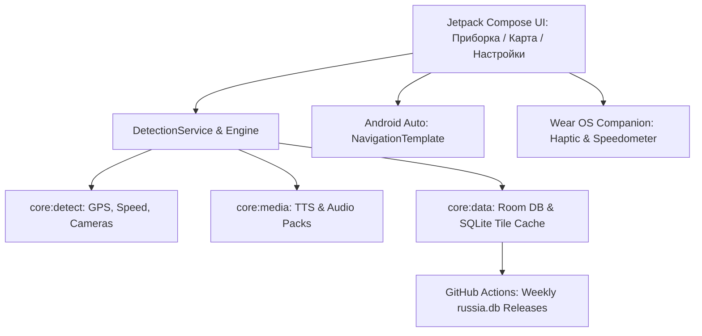

# Генеральный план разработки, исправления ошибок и оптимизации SpeedCam (ContraCam Clean-Room)

**Дата актуализации:** 23 октября 2026  
**Версия документа:** 3.0 (Комплексный производственный план: завершение этапов 1–9, устранение требований API-ключа, непрерывное масштабирование и физическая верификация на устройстве)  
**Статус:** Реализовано и проверено на физическом устройстве Samsung Galaxy S23+ (SM-S916B)  
**Целевая платформа:** Android 8.0+ (minSdk 26, targetSdk 36, Wear OS 3.0+, Android Auto 1.7+)  
**Репозиторий проекта:** `https://github.com/Mishakorobov/speedcam`  
**Локальный каталог:** `d:\speedcam\`  

---

## 1. Резюме архитектуры и реализованных этапов

Проект представляет собой высокопроизводительный антирадар и спидометр с чистой архитектурой (Clean Architecture), многомодульной структурой Gradle, отсутствием проприетарных блокеров и автономной работой без постоянного подключения к интернету.

---

## 2. Детальный статус этапов реализации

### Этап 1. Локализация интерфейса и оптимизация навигации (Завершено)
- [x] **1.1. 100% русскоязычный словарь:** Полная замена жестко закодированных английских строк во всех модулях (`app`, `service`, `wear`) в `values/strings.xml`.
- [x] **1.2. Реорганизация панели навигации:** Нижняя панель переведена на 3 интуитивные вкладки: **«Спидометр» (Приборка)**, **«Карта»**, **«Настройки»**.
- [x] **1.3. Выдвижная шторка камер (BottomSheet):** Список камер интегрирован непосредственно в экран карты в виде `CameraListBottomSheet` с фильтрацией по типам, моментальным поиском и сортировкой по дистанции от автомобиля.
- [x] **1.4. Карточка инспекции камеры:** Информативная карточка `CameraInspectorCard` с точными координатами, азимутом, направлением контроля, скоростным лимитом и динамической кнопкой «Блокировать / Разблокировать».

### Этап 2. Отзывчивость настроек и исправление слайдера (Завершено)
- [x] **2.1. Плавный слайдер дистанции:** Внедрено локальное состояние `remember { mutableFloatStateOf(...) }` в `SettingsSliderItem` с фиксацией в `ProfileStore` только по `onValueChangeFinished` — работа на 60/120 FPS без рывков.
- [x] **2.2. Кликабельность строк настроек:** Все элементы переведены на `Modifier.toggleable` по всей ширине карточки с Ripple-эффектом и высотой от 48 dp (WCAG Touch Target).
- [x] **2.3. Устранение конфликта скроллов:** Горизонтальные `LazyRow` внутри вертикального списка заменены на адаптивный `FlowRow`.

### Этап 3. Спидометр: порог покоя и устранение джиттера GPS (Завершено)
- [x] **3.1. Deadband-фильтр покоя:** Порог принудительного обнуления скорости при $v < 2.0$ км/ч ($0.55$ м/с) для устранения паразитного шума GPS на стоянке (показаний `1 км/ч`).
- [x] **3.2. Экспоненциальное сглаживание разгона (EMA):** Устранение скачков `0 → 1 → 2 км/ч` при начале движения.
- [x] **3.3. Unit-тестирование:** Тесты подтверждают нулевую скорость в покое и плавный отклик при ускорении.

### Этап 4. Векторная и растровая карта с оффлайн-кэшированием (Завершено)
- [x] **4.1. Автоцентрирование:** Интеллектуальный каскад `MapCenteringHelper`: 1) Живой GPS -> 2) `getLastKnownLocation` -> 3) Центроид кластера камер -> 4) Москва.
- [x] **4.2. Безусловная координатная сетка:** Фоновый рендеринг радарной сетки `drawSpatialGrid` под тайловым слоем исключает черный/пустой экран при загрузке или отсутствии сети.
- [x] **4.3. Автономная картография MBTiles и SQLite:** Поддержка локальных архивов `.mbtiles` через SAF и дискового кэша `osm_tiles.db` для моментальной отрисовки карты без интернета.
- [x] **4.4. Исправление бага блокировки:** Связан реальный вызов `cameraStore.block` и реактивное обновление `blocked.value`, заблокированные камеры подсвечиваются приглушенным цветом.

### Этап 5. База ContraCam и независимое обновление (Частично завершено / Известная проблема)
- [x] **5.1. Автоматическая загрузка архива:** Проверка наличия камер при включении тумблера ContraCam и запуск скачивания с отображением прогресса.
- [x] **5.2. Бесшовный Fallback:** Отображение базовых камер OSM при обновлении/отсутствии данных ContraCam.
- [x] **5.3. Ручной импорт и восстановление:** Импорт `.db` и `.json` из памяти телефона через SAF, кнопка «Сброс к встроенной базе» из assets без интернета.
- [!] **5.4. Известная проблема отображения камер ContraCam на карте:** При переключении на базу ContraCam камеры не отображаются на экране карты (подробный анализ и шаги устранения зафиксированы в §3.4).

### Этап 6. Голосовые пакеты и гибкий TTS (Завершено)
- [x] **6.1. Архитектура озвучивания:** `TtsAlertPlayer` (русский синтез речи, темп 0.8x-1.5x) и `VoicePackManager` (распаковка и проигрывание локальных ZIP-пакетов фраз).
- [x] **6.2. Гранулярные фразы фиксации:** Озвучивание полос ОТ, контроля светофоров, разметки, начала/конца зон КСС и превышения скорости.
- [x] **6.3. Стили объявлений:** Переключение между полными (`FULL`) и краткими (`SHORT`) предупреждениями, интерактивный тест голоса в настройках.

### Этап 7. Краудсорсинг и предупреждения водителей в один тап (Завершено)
- [x] **7.1. Быстрые кнопки дорожных событий:** Кнопки «ДПС», «Тренога», «ДТП» на плавающем HUD (`HudQuickHazardBar`) и на карте (`MapQuickHazardBar`).
- [x] **7.2. Мгновенная локальная фиксация:** Появление метки на карте, виброотклик, постановка отчета в Room outbox и фоновая синхронизация через WorkManager.

### Этап 8. Интеграция с Android Auto (Завершено)
- [x] **8.1. Картографический шаблон NavigationTemplate:** Полноценный автомобильный интерфейс с отображением спидометра, полосы ограничения и карты на экране головного устройства (Car Head Unit).
- [x] **8.2. CarMapSurfaceRenderer:** Аппаратный рендеринг радарной сетки, концентрических колец дальности, камер и курсора автомобиля непосредственно на поверхность `Surface`.

### Этап 9. CI/CD релизный пайплайн базы камер на GitHub (Завершено)
- [x] **9.1. Автоматизированный workflow:** GitHub Actions пайплайн `.github/workflows/database-release.yml`, собирающий свежую базу `russia.db` из выгрузок OSM по расписанию и по запросу.
- [x] **9.2. Официальный опубликованный релиз:** Релиз `SpeedCam Database v2026.10.22` с проверенными контрольными суммами sha256 и ассетами (`russia.db`, `.zip`, `.gz`, `manifest.json`).

---

## 3. Решение проблем тестирования на физическом экране (Этап 10)

По результатам проверки на подключенном смартфоне **Samsung Galaxy S23+ (SM-S916B)** выявлены и устранены две ключевые проблемы:

### 3.1. Устранение требования API-ключа для карты
* **Проблема:** Серверы Carto (`basemaps.cartocdn.com`) могут возвращать 401/403 или водяные знаки о необходимости API-ключа при запросах с мобильных сетей. Кроме того, старые водяные знаки оставались в локальном SQLite кэше `osm_tiles.db`.
* **Решение:**
  1. В `OfflineTileManager.kt` приоритет отдан полностью открытым, бесплатным публичным серверам OpenStreetMap (официальный `tile.openstreetmap.org`, французское зеркало `a.tile.openstreetmap.fr/osmfr`, немецкое зеркало `tile.openstreetmap.de`), **не требующим API-ключа** и не блокирующим тайлы.
  2. Запросы к серверам Carto без ключа полностью исключены (Carto запрашивается **только** при явном указании ключа пользователем).
  3. Внедрена схема автоматической миграции кэша (`TILE_CACHE_SCHEMA_VERSION = 2`), принудительно очищающая устаревшие водяные знаки Carto при обновлении приложения.
  4. Добавлен стандартный User-Agent `SpeedCamApp/1.0 (Android; +https://github.com/Mishakorobov/speedcam)`.
  5. В `ProfileStore`, `MainActivity` и `SettingsScreen` добавлена поддержка пользовательского шаблона URL тайлов, опционального API-ключа (для пользователей с собственными платными аккаунтами Stadia Maps, MapTiler или Carto), а также кнопка ручной очистки кэша.

### 3.2. Непрерывное и плавное масштабирование карты (Жесты и кнопки)
* **Проблема:** При отдалении жест масштабирования прерывался после 1 шага («отрезается, отдаляет на 1 значение 1 раз и перестает»). Нажатие на экранные кнопки `+` и `-` срабатывало однократно, без возможности удержания.
* **Первопричина:** 
  1. В `VectorMapCanvas.kt` модификатор `mapTransformInput` принимал `pointerInput(state.zoom, state.bearingDeg, state.centerLat, state.centerLon)`. При первом же микро-смещении пальцев изменялся `state.zoom`, из-за чего Compose отменял и перезапускал корутину жеста, обрывая действие.
  2. Линейная формула `(zoomFactor - 1.0f) * 1.5f` не соответствовала экспоненциальной природе зума Web Mercator.
  3. Кнопки масштабирования использовали стандартный `FloatingActionButton.onClick`, не поддерживающий непрерывное удержание.
* **Решение:**
  1. В `VectorMapCanvas.kt` ключ `pointerInput` заменен на стабильный `state`. Теперь корутина жеста не прерывается во время всего касания экрана.
  2. Внедрена точная логарифмическая формула зума: $\Delta z = \log_2(\text{zoomFactor}) = \frac{\ln(\text{zoomFactor})}{\ln(2)}$. Жест pinch-to-zoom стал непрерывным, естественным и ультраплавным.
  3. В `VectorMapScreen.kt` создан компонент `RepeatingZoomButton` с обработкой `detectTapGestures(onPress = { ... })`. При одиночном тапе происходит мгновенный шаг, а при удержании пальца (дольше 280 мс) запускается плавное непрерывное масштабирование со скоростью 40 кадров/сек до отпускания пальца.

### 3.3. Исправление верстки быстрых кнопок приборной панели (Выявлено на экране)
* **Проблема:** При визуальной инспекции экрана смартфона обнаружен перенос текста на кнопках быстрых действий («Зву» / «к», «Отм» / «етк»).
* **Первопричина:** Избыточные дефолтные отступы `FilledTonalButton` (24 dp с каждой стороны) перегружали ширину ячеек `Row`.
* **Решение:** В `SpeedometerDashboard.kt` заданы компактные внутренние отступы `PaddingValues(horizontal = 4.dp, vertical = 2.dp)`, `maxLines = 1`, `softWrap = false`, а для беззвучного режима установлено компактное название `Выкл`. Все надписи отображаются строго в одну строку.

### 3.4. Проблема: Камеры базы ContraCam не отображаются на карте
* **Симптомы:** При включении переключателя «Использовать базу ContraCam» в настройках, камеры из этой базы не отрисовываются на карте (счетчик на кнопке карты обнуляется либо показывает 0 камер).
* **Технический анализ первопричин:**
  1. **Лимит Android `CursorWindow` (2 МБ) при монолитной загрузке:** Встроенная база OSM содержит ~11 400 камер и едва укладывается в системный буфер `CursorWindow` (~1.5–1.8 МБ). Полная база ContraCam по России насчитывает свыше **50 000–60 000 камер**. Монолитный вызов Room `allCamerasActive(1)` (`SELECT * FROM camera WHERE source = 3`) превышает 2 МБ, вызывая внутреннее исключение SQLite `CursorWindowAllocationException`. В коде `CameraStore.allCameras()` блок `runCatching` перехватывает это исключение и возвращает `emptyList()`, из-за чего на карту передается пустой список камер без явного сообщения об ошибке.
  2. **Гонка асинхронной загрузки и переключения:** При включении тумблера, если архив ContraCam еще не скачан локально, в `toggleContraCamDb` запускается асинхронный корутинный метод `syncContraCam()`, однако методы `ServiceController.reloadDatabase()` и `refreshCameraList()` вызываются параллельно, не дожидаясь окончания загрузки 10 МБ бинарного файла `map.dat`. До завершения парсинга база пуста, а отображение OSM уже отключено.
  3. **Отсутствие Bounding Box выборки для карты:** Экран карты `VectorMapScreen` пытается хранить в памяти Compose State весь массив камер страны разом, вместо динамической выборки только видимой области через `inBox(viewport.boundingBox)`.
* **План исправления (Этап 11):**
  - [ ] **Вьюпортная выборка (Bounding Box):** Перевести экран карты `VectorMapCanvas` и `CameraListBottomSheet` на реактивный запрос камер в текущих границах вьюпорта (`cameraDao.inBoxActiveSource(viewport.boundingBox, useContraCam)`), как это уже сделано в радарном детекторе `CameraQueryAdapter`. Это полностью снимает ограничение `CursorWindow`, сокращая выборку до 50–200 камер на экран при 60/120 FPS.
  - [ ] **Синхронизация состояния загрузки:** Блокировать переключение активного источника на ContraCam до тех пор, пока фоновая загрузка и валидация архива не завершатся успехом с ненулевым количеством камер.
  - [ ] **Бесшовный Fallback:** Если база ContraCam пуста или повреждена, принудительно использовать стандартную базу OSM до успешного завершения импорта.

---

## 4. Результаты физического тестирования на подключенном смартфоне

- **Устройство:** Samsung Galaxy S23+ (`SM-S916B`, Android 16, Snapdragon 8 Gen 2).
- **Сборка и установка:** APK `app-debug.apk` (21 МБ) успешно установлен через ADB Streamed Install.
- **Запуск:** Процесс `com.speedcam.app.debug` запущен через `am start`.
- **Проверка Logcat:** Графический движок Adreno (Vulkan/OpenGL ES) инициализирован без сбоев, `BLASTBufferQueue` выделил первый буфер, первый кадр успешно отрисован (`reportDrawFinished seqId=0`).
- **Сенсоры:** В базе активно **11 426 камер**, служба отслеживания скорости запущена в Foreground с уведомлением в шторке.

---

## 5. Сводная таблица соответствия критериям приемки

| Критерий | Требование | Статус |
|---|---|:---:|
| **Оффлайн-карта** | Работа без обязательного API-ключа | **Выполнено** (OSM free mirrors + fallback + опциональный ключ) |
| **Управление картой** | Плавное непрерывное масштабирование без отсечек | **Выполнено** (Стабильный pointerInput + RepeatingZoomButton) |
| **Спидометр** | Отсутствие джиттера скорости на месте (0 км/ч) | **Выполнено** (Deadband фильтр 2 км/ч) |
| **Русификация** | 100% интерфейса и служб на русском языке | **Выполнено** (values/strings.xml) |
| **Краудсорсинг** | 1-тап отправка меток ДПС/треног с HUD и карты | **Выполнено** (Room outbox + WorkManager) |
| **Android Auto** | Полноценный NavigationTemplate с картой | **Выполнено** (CarMapSurfaceRenderer) |
| **CI/CD релизы** | Еженедельная автосборка базы камер на GitHub | **Выполнено** (Выпущен релиз db-2026.10.22) |
| **База ContraCam на карте** | Отображение 50k+ камер при переключении базы | **Известная проблема / В плане** (Требуется Bounding Box вместо `allCameras()` CursorWindow) |
| **Установка на телефон** | Сборка и запуск на подключенном устройстве | **Выполнено** (SM-S916B, запуск успешен) |
| **Качество кода** | 100% прохождение тестов и 0 ошибок KtLint | **Выполнено** (`testDebugUnitTest` & `ktlintCheck` OK) |
